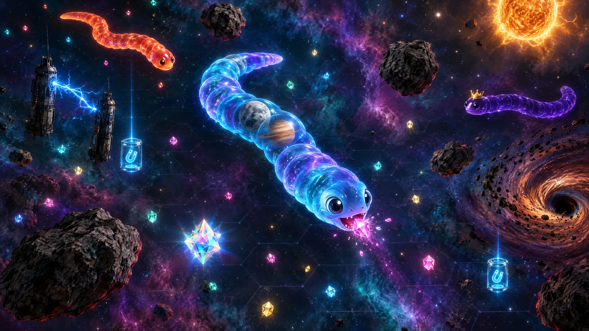
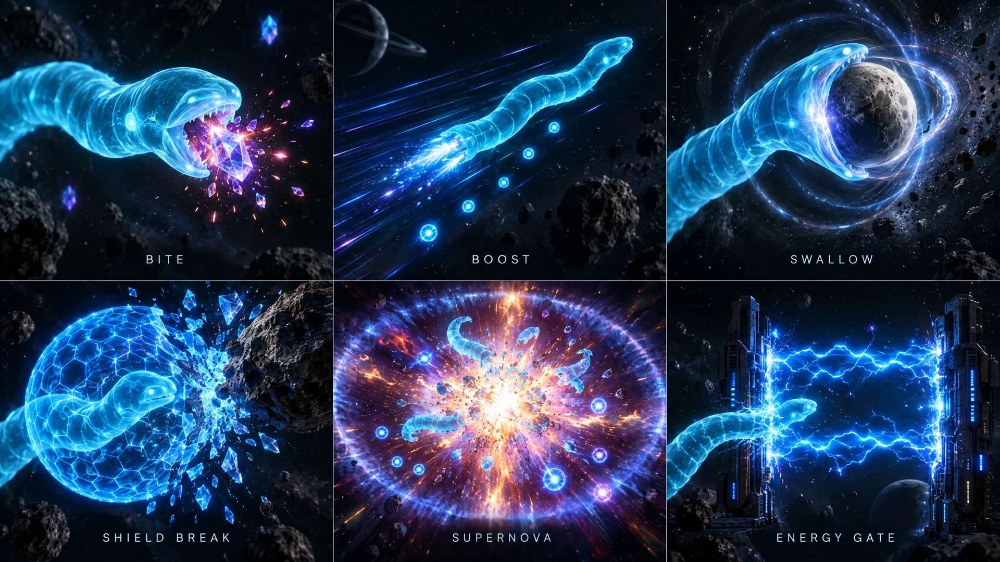
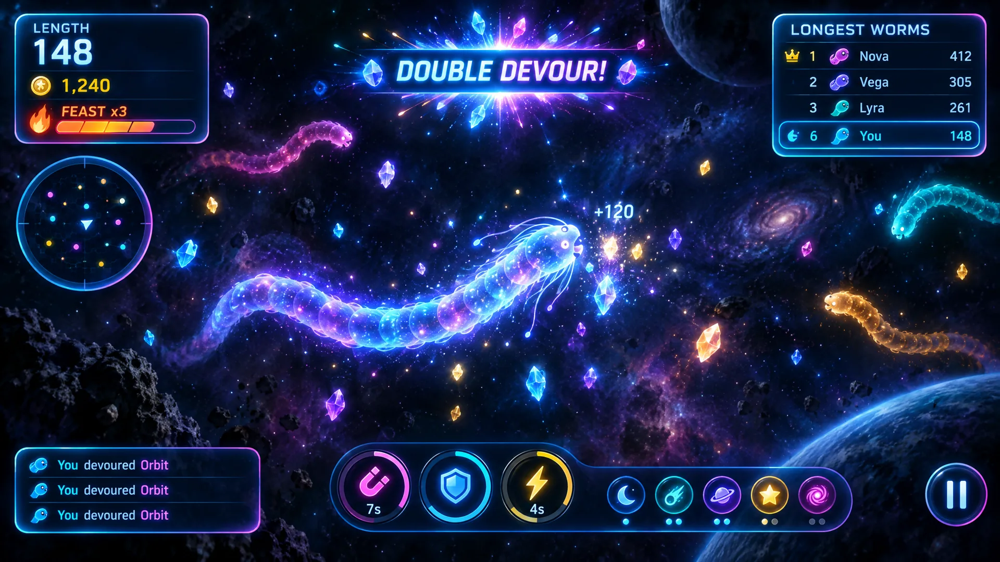
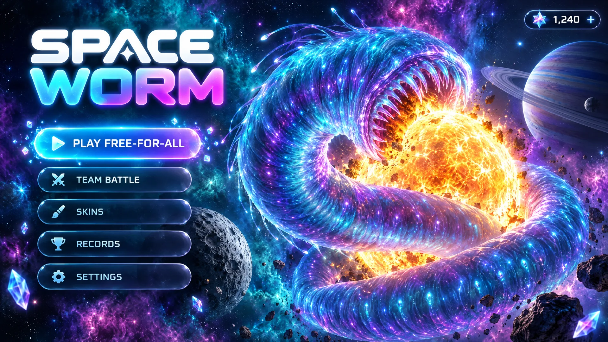

# Space Worm — Concept Proposal: "Cosmic Feast"

Concept overhaul for the existing Three.js build of Space Worm. The goal is to keep the rules small enough to learn in seconds, which is the strength of the genre, and make every action look, sound and feel good. The research behind the proposal is in [research-notes.md](research-notes.md). The concept images are in [concepts/](concepts/).

## 1. What makes the genre fun

| Game | Core loop | What keeps players hooked | What we take |
| --- | --- | --- | --- |
| **slither.io** | Eat orbs → grow → trap rivals with your body → eat their remains | Any head-to-body contact kills, whatever the size ("David vs Goliath"). A live top-10 board. Chaotic feeding frenzies when a giant dies. Length grows roughly with the square root of mass, and the camera zooms out as you grow. | Death spills the worm's mass along its whole body. A "Supernova" frenzy moment when a big worm dies. A size-aware camera. A clear top-10 list. |
| **agar.io** | Absorb smaller cells, flee bigger ones | A constant sense of prey versus predator. Critics find it slow and predictable because the big one almost always wins. | Keep size from guaranteeing a win. Keep the pace fast. |
| **Snake.io** (Kooapps) | slither.io loop on mobile, offline bots | Special pellets (worth 10 points, speed, invincibility), monthly events with unique skins. Players complain that invincibility lets snakes pass through others. | Rare "Nova Mote" jackpot pellets. The shield only absorbs environmental hits, never other worms, which avoids that complaint. |
| **Wormate.io** | Candy-themed slither.io | Speed-up, zoom-out and magnet power-ups. Score multipliers (x2, x5, x10). Tasty, colourful food. | A Feast Combo multiplier. Food that looks worth eating. The magnet power-up already exists. |
| **Little Big Snake** | slither.io loop with bosses, quests and chests | Missions ("eat 10 bubbles") and a bounty on the current king. | A Bounty Crown on the #1 worm that pays bonus stardust. Run milestones shown as HUD toasts. |

**Common criticisms we fix:** bland art, **no music or sound (it feels unfinished)**, imprecise controls and noisy screens. Our answer is photographic space art, fully produced adaptive music and SFX, instant and readable feedback, and juice that never hides the play space.

**Juice principles we follow** (from "Juice It or Lose It", GDC 2012, and later practitioners):

1. Respond to every input with cascading feedback.
2. Keep camera shake short (80–150 ms) and never during fine steering.
3. Keep small actions visually clean and save the big effects for big moments.
4. Layer sounds and randomise pitch.
5. Reduced-motion mode removes shake and flashes but keeps the information.

## 2. Pillars

1. **Tasty** — every mote, planet and rival looks edible and worth chasing.
2. **Readable chaos** — the screen can be full of sparks, but heads, bodies and hazards always stand out from them.
3. **Cosmic realism with bioluminescent life** — the space is photographic: nebulae, cratered moons, banded gas giants, burning stars. The worms are glossy, living jelly creatures that glow softly against it.
4. **No glare** — environmental surfaces are matte with low emission. Glow is reserved for living things, energy and pickups.

## 3. Gameplay improvements

| Feature | Description | Why |
| --- | --- | --- |
| **Remnant spill** (upgrade) | On death the whole body bursts into large "remnant" motes laid out along the body line, tinted to the worm's skin. Swallowed celestial bodies are ejected back into space as free celestials. | Creates slither.io's feeding-frenzy chaos. Celestial loot changes hands. |
| **Supernova** | Worms of length 80+ die in a supernova: a flash, a shockwave ring, and the camera kicks slightly. Remnants glow brighter. | A big shared moment that pulls everyone in. |
| **Feast Combo** | Eating within 1.2 s of the last bite raises a combo (x1 → x5). The combo multiplies stardust earned. Milestones at 10, 25 and 50 bites pop callouts. | Rewards flow and aggressive routing (Wormate multipliers). |
| **Nova Motes** | Rare large prismatic motes worth 10 length. They pulse and are shown on the minimap. | Jackpot moments to chase (Snake.io special pellets). |
| **Bounty Crown** | The current #1 worm wears a crown. Killing it pays +50 stardust and a "Crown Taken!" banner. | Gives small worms a reason to hunt big ones (David vs Goliath). |
| **Kill streak callouts** | Devour, Double Devour, Rampage, Cosmic Menace. | Short-term goals and bragging rights. |
| **Size-aware camera** | The camera zooms out smoothly as length grows, and briefly punches in on celestial swallows. | Genre-standard readability. |

Existing systems (FFA and team modes, celestial powers, the three temporary power-ups, the three hazards, progression, the leaderboard, accessibility) stay as they are and get the visual and audio treatment below.

## 4. Visual direction

| Element | Current | New direction |
| --- | --- | --- |
| **Backdrop** | Flat dark gradient with point stars | A painted photographic nebula backdrop far below the arena, a parallax star field in 3 depths, drifting dust. |
| **Arena floor** | Bright hex grid plate | Nearly invisible: a faint gravitational lattice (low opacity, no reflections) over the deep backdrop. The arena rim is a soft plasma curtain that brightens only when you are near it. |
| **Worm body** | Plain glossy spheres | Translucent bioluminescent jelly segments: a subsurface-style inner glow, rim light, and a soft darker core. A swallow bulge travels down the body when eating. A breathing wave. Skin patterns. |
| **Worm head** | Sphere with eyes | Larger head with expressive eyes that look toward the steering direction and blink. The mouth opens near food. It squash-stretches on each bite. |
| **Celestial bodies** | Flat-coloured spheres | Realistic textured bodies: a cratered moon, an icy comet with a particle tail, a banded gas giant with a ring, a star with animated surface and corona, and a pulsar with rotating beams. |
| **Celestial segments** | Sphere in body | The actual textured celestial body, held in a translucent membrane of the skin colour. It keeps rotating. |
| **Asteroids** | Faceted grey rocks | Rough rocky bodies with normal detail, fully matte. A dim red danger rim appears only when close. |
| **Energy gates** | Pylons with a beam | Metal pylons. The beam is an animated electric arc with sparks. A warning flicker before it goes live. |
| **Gravity wells** | Purple discs | A swirling accretion vortex with debris particles spiralling inward and a dark centre. |
| **Food motes** | Coloured dots | Small faceted crystals with a soft halo and twinkle. Streak trails when a magnet sucks them in. |
| **Pickups** | Floating shapes | Holographic capsules with the power-up icon inside, a rotating ring and a vertical light beam. |
| **Particles** | Plain additive dots | Textured sprites (sparks, glows, smoke, rings, stars) from the Kenney Particle and Smoke packs in the game asset catalog. |

**Glare policy:** environmental materials use roughness 0.8–1.0, metalness below 0.2 and low emission, and bloom has a high threshold, so only intended glows bloom.

## 5. VFX and juice catalogue

| Trigger | Visual | Audio | Camera / HUD |
| --- | --- | --- | --- |
| Eat mote | Head squash-stretch, coloured spark pop, bulge down body | Soft bite "pop", pitch rises with combo | Length counter ticks and punches |
| Nova Mote | Prismatic burst, star sparks, ring | Crystal chime | "+10" float text |
| Boost | Thruster sparks from tail, stretched afterimage on head, speed streaks, mass pellets dropped | Whoosh loop | Slight FOV widen |
| Swallow celestial | Gravitational lensing ring, flash, body-coloured shockwave, segment slides in | Deep "gulp" plus cosmic swell | Short zoom punch, power toast flies to the powers bar |
| Pickup activate | Coloured shockwave, icon flies from world to the HUD timer | Power-up riser | Timer ring sweeps in and sparkles |
| Timer ending | Ring blinks, sparks fall off | Tick at 3, 2, 1 | — |
| Shield absorbs hit | Hex bubble flashes, shatters into shards | Glass shatter | 100 ms shake |
| Gate zap / near | Arc sparks, crackle | Electric crackle | — |
| Gravity well | Debris spirals, body tint | Low hum (distance-scaled) | Slow-down vignette |
| Kill a rival | Supernova of rival colours, remnants spill | Explosion plus kill sting | Callout banner, kill-feed entry with icon |
| Die | Your body shatters into remnants, slow-motion 0.4 s | Heavy impact, music ducks | Death card slides in |
| Combo milestone | Fire ring on head | Rising arpeggio | Combo meter flames |
| **HUD / UI** | Buttons shimmer on hover and burst into particles on click. Stardust coins fly to the wallet. Menu nebula drifts in parallax. Rank changes flash. Unlocking a skin fires confetti. | Hover tick, click, purchase chime | — |

Reduced motion removes shake, slow-motion, flashes and parallax, and keeps particles subtle.

## 6. Audio design

| Asset | Source | Notes |
| --- | --- | --- |
| Title / menu theme | Lyria 3 Pro | Dreamy space synthwave, 100 BPM, loops |
| Arena theme (calm layer) | Lyria 3 Pro | Driving but spacious, 120 BPM |
| Arena theme (intense layer) | Lyria 3 Pro | Same key and tempo, heavier drums and arps. Crossfades in with "heat": nearby rivals, boosting, combo, frenzy. |
| Match results sting | Lyria 3 Pro (short) | Victory or defeat |
| Gameplay SFX (≈20) | ElevenLabs sound generation | Bite, gulp, boost, pickup, shield, gate, well, explosion, kill, death, UI hover/click/purchase, countdown |

A separate music bus and SFX bus are kept, both configurable. Pitch and volume are randomised per play.

## 7. Staged loading plan

Stages follow natural progression milestones rather than waves:

| Stage | Contents | When |
| --- | --- | --- |
| **0 — Boot** | Loading background, fonts, UI icons, title music (streamed) | Before the title screen (the only blocking load) |
| **1 — Arena opening** | Backdrop, moon/comet/asteroid textures, particle sprites, core SFX, arena calm music | Starts right after the title screen shows. Required before the first match. |
| **2 — Mid-game** | Gas giant and ring, gate and well textures, intense music layer | Prefetched right after stage 1 |
| **3 — Late game** | Star and pulsar textures, rare SFX, result stings, skin previews | Background prefetch |

The prefetch scheduler loads one asset at a time during idle time. It **pauses** when the frame time is above 20 ms, the particle count is above 60 % of the pool, or more than 8 worms are on screen, and resumes after 1.5 s of calm. If a match starts before stage 1 finishes, the game shows a short "Charging the arena…" progress overlay. If a later asset is late, the game uses a procedural fallback so play never blocks.

## 8. HUD UI concept

- **Top-left:** a length plate with a big animated number, a stardust counter and the combo meter.
- **Under it:** the minimap in a glass ring frame.
- **Top-right:** the top-10 list with crown, team colours and your highlighted row.
- **Bottom-centre:** effect timers (ring sweeps with icons) and celestial power pips.
- **Callouts:** centre-top banners with a particle burst.
- **Touch:** a steering stick on the left and a large boost button on the right with a charge ring.

## 9. Title, loading and sharing

The loading screen uses a new painted "worm swallowing a star" background with a progress ring. The OG card and favicon are regenerated to match the new art.

## 10. Scope and acceptance

- Every row in sections 3–8 is implemented in the current Three.js project.
- Screenshots of the build match the concept images in palette, material feel and composition.
- Initial blocking load is stage 0 only. Stages 1–3 stream with the heat-aware pause.
- Unit tests, smoke tests and the production build pass, and a checkpoint is saved.
