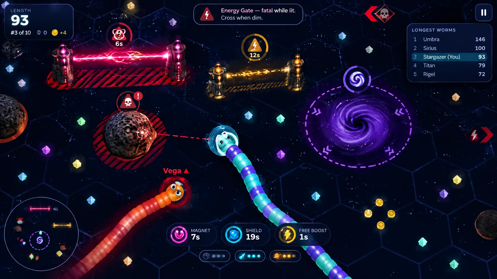

# Space Worm — Concept Proposal: "Threat Language"

> **Player feedback:** "It's not immediately clear what the enemies are that we need to avoid, like the evil clouds and lightnings and stuff."

This proposal introduces one consistent visual vocabulary for danger, so players can sort everything on screen into **"eat it"**, **"avoid it"** and **"it slows me"** at a glance. That applies to first-time players and to players in a busy fight.

## 1. Why players are confused today

An audit of the current build (commit `9568d89`) found five root causes.

| # | Problem | Evidence in the build |
|---|---|---|
| 1 | **Danger shares the "good" palette.** Active energy gates glow **cyan-white**, which is the same family as food gems, the magnet and the shield. The dangerous "lightning" looks like a reward. | `view.ts` gate shader `onC = vec3(0.55, 0.95, 1.0)` |
| 2 | **Gravity wells look like decoration.** The swirling "evil cloud" is a pretty purple/cyan spiral with no boundary, no icon and no hint of what it does. | Well disc shader; the minimap well is a 28% violet blob |
| 3 | **Asteroid danger is subtle.** The only cue is a 22%-opacity orange ring under the rock, and the rock itself is a dull grey that blends into the dark floor. | `glow` ring, `opacity: 0.22` |
| 4 | **Rival worms are not marked as threats.** Rival heads get a faint 25% halo in their own skin colour. Nothing says "touching this body kills you" or "this one is bigger than you". | `makeHead` halo |
| 5 | **No anticipation.** Nothing warns you before you steer into a hazard, nothing points at threats just off-screen, and the only explanation is a text line in *How to play*. | No look-ahead, no edge indicators, no first-encounter tips |

## 2. Design pillars

1. **Reserve red for danger.** Lethal things are red, and lethal things only. Pickups, food and allies keep cyan, green and gold.
2. **Shape, not only colour.** Every threat class has its own glyph and outline pattern, so the system also works for colour-blind players and on dim phone screens.
3. **Loud only when it matters.** Hazards far from your path stay calm and readable. A threat escalates (brighter, pulsing, "!") only when *your* predicted path meets it.
4. **Teach once, then trust the player.** A short tip appears the first time you meet each hazard type, then never again unless you reset hints.

## 3. The threat vocabulary

| Class | Colour | Glyph | Ground mark | Meaning |
|---|---|---|---|---|
| **Lethal, always** (asteroids, arena rim) | Hazard red `#ff3b4e` | Skull in a warning triangle | Red **hazard-striped** ring around the kill radius | Touching it ends your life |
| **Lethal, timed** (energy gates) | Red when lit, **amber** `#ffb020` while charging, dim slate when off | Lightning bolt in a triangle, plus a countdown ring | Striped **lane** footprint along the beam when charging or lit | Dim = safe to cross, amber = get out, red = fatal |
| **Hinders** (gravity wells) | Violet `#a066ff` | Spiral with inward chevrons ("slows") | **Dashed** violet boundary ring with chevrons flowing inward | Not fatal, but slows you and pulls you in |
| **Hostile worm** (rival bodies) | Red head ring; a crossed-swords badge on bigger rivals | Name tag turns red with a ▲ when the rival is longer than you | Faint red **underglow** under rival bodies near you | Their body is a wall; a bigger head wins head-on clashes |
| **Ally** (team mode) | Team blue | Shield badge | Blue underglow | Pass through harmlessly |

## 4. Features

### 4.1 Hazard recolour pass (fixes #1–#3)
- **Energy gate lightning:** off = dim slate dashes; charging = flashing amber; lit = **red-magenta lightning** with a hot white core. Pylon tips follow the same states.
- **Gravity well:** keep the violet swirl but drop the cyan so it reads as one "anomaly" colour. Add a crisp dashed boundary ring and inward-flowing chevrons that show the pull.
- **Asteroids:** a warmer, higher-contrast rim light plus the striped red kill ring.

### 4.2 World-space threat badges
Billboard icons float above every hazard: a skull triangle over asteroids, a bolt triangle with a **countdown arc** over each gate's midpoint, and a spiral over wells. They are drawn procedurally on canvas, so there are no new downloads, and they fade out beyond a comfortable view distance.

### 4.3 Look-ahead danger detection (fixes #5)
Every frame, the game projects the player's head **1.1 seconds ahead** along its current heading and speed, and scores every hazard and rival body along that path:
- **Clear** (level 0): calm markers.
- **Near** (level 1): the marker brightens and the ground ring gains contrast.
- **Imminent** (level 2): the marker pulses, a red "!" pops above it, a thin red **reticle** appears in front of your head pointing at the danger, and a soft rate-limited warning tick plays.

Gates are scored by what they will be doing **when you arrive**. A gate that is charging now but will be lit in 0.8 s counts as lethal on a 1.1 s path.

### 4.4 Off-screen threat arrows
Red chevrons on the screen edge point toward dangers you can't see yet: gates that are charging or lit near your path, and **bigger rival heads that are closing in**. Each arrow carries the threat glyph. Arrows scale with urgency, and at most 4 appear at once.

### 4.5 Rival identification (fixes #4)
- A red threat ring under every rival head. In team mode, allies get a blue ring with a shield badge.
- The name tag turns red with a **▲** when the rival is longer than you, meaning they win a head-on clash.
- A faint red underglow traces rival bodies within 40 units of you, so the "wall" is obvious in a crowd.

### 4.6 First-encounter tips
The first time each threat enters view, a compact card slides in with its icon and one line, for example *"Energy Gate: fatal while lit. Cross when it is dim."* Seen hints are stored in the save. **Settings → Reset hints** brings them back.

> **Implementation note:** the concept placed the card at the top centre. In the build it sits at the **bottom centre, above the effect timers**, because the top centre is already used by the crown chip, the team scoreboard and gate badges.

### 4.7 Minimap, How to play, and death screen
- **Minimap:** hazard red for asteroids and lit gates, blinking amber for charging gates, dashed violet wells, red dots for bigger rivals, blue dots for allies.
- **How to play:** a visual **threat legend** that uses the same glyphs.
- **Death screen:** the cause line gets its threat glyph plus one actionable tip, for example *"Tip: gates flash amber before they fire. Wait for them to go dim."*

### 4.8 Settings and accessibility
- **Threat highlights:** *Full* (default) or *Minimal*. Minimal keeps the recolour, ground marks, minimap and tips, but hides badges, arrows and reticles.
- **Reduced motion:** no pulsing, no flowing chevrons and no flashing. Every state stays readable through static colour and shape.
- Glyph shapes differ per class, so meaning never depends on colour alone.

## 5. Implementation plan

| Step | Module | Work |
|---|---|---|
| 1 | `src/game/threats.ts` (new, pure) | Look-ahead path sampling, hazard scoring for asteroids, gates (phase at arrival time), wells, rim and rival bodies/heads; off-screen arrow list; first-seen detection. No three.js, so it is unit-testable. |
| 2 | `tests/threats.test.ts` (new) | Straight path into an asteroid gives imminent; a gate that is off now but lit on arrival counts as lethal; wells give "hinders", not lethal; teammates are never threats; bigger rival heads are flagged. |
| 3 | `src/game/threatMarks.ts` (new, three.js) | Canvas glyph textures, badge sprites with countdown arcs, a striped/dashed ground-ring shader, gate lane footprints, rival underglow instancing and the head reticle. It is driven by the analysis from step 1. |
| 4 | `src/game/view.ts` | Recolour the gate and well shaders, raise asteroid contrast, add rival/ally head rings and red name tags, and hook up `threatMarks`. |
| 5 | `src/game/game.ts` | Run the threat analysis each frame, expose `threats` (arrows, imminent flag, new hints) in `HudState`, and trigger the rate-limited warning tick. |
| 6 | `src/ui/ui.ts`, `src/ui/minimap.ts`, CSS | Off-screen arrow layer, hint cards, How-to threat legend, death-screen tip, threat-highlight setting and reset-hints button, minimap recolour. |
| 7 | `src/engine/save.ts` | `threatMode: 'full' \| 'minimal'` and `seenHints: string[]`, with migration defaults. |
| 8 | `src/i18n/en.json`, `zh-CN.json` | All new copy (hints, legend, tips, settings), keeping the two dictionaries in parity. |
| 9 | Verify | Typecheck, unit tests, smoke test, desktop/mobile/Chinese captures compared with the concept, then the full publishing build command and a checkpoint. |

**Performance budget:** the analysis is O(hazards + nearby segments), about 0.1 ms. Badges are fewer than 40 sprites that share textures. The underglow reuses one instanced mesh.

**No new downloaded assets:** every glyph is drawn procedurally on canvas, so the loading stages don't change.
